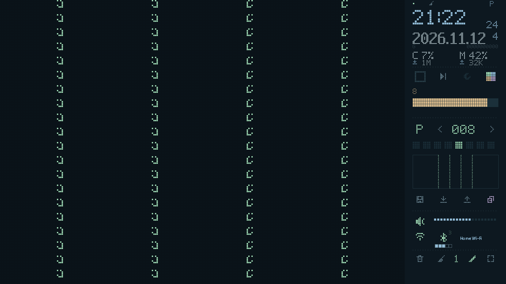
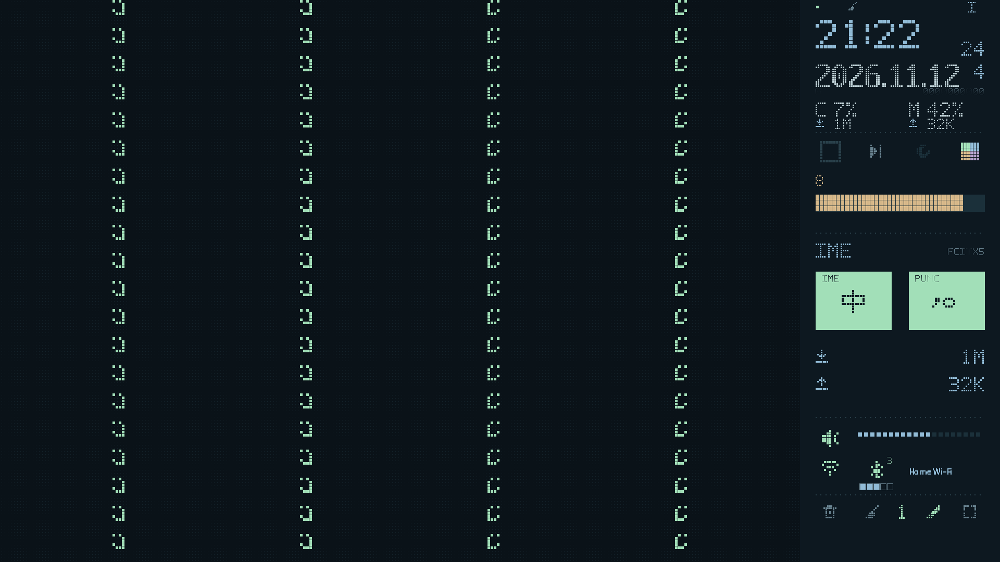
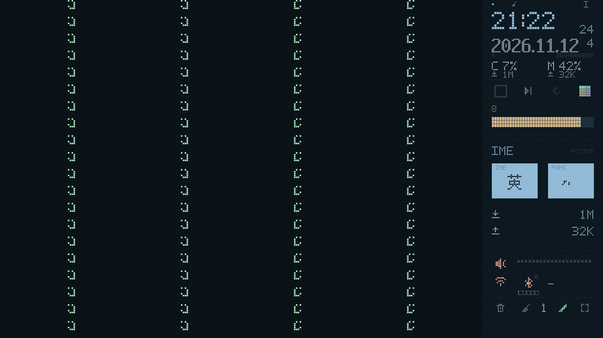

# 生命场 · 原生应用实验版

先阅读 [方案与能力边界](docs/DESIGN.md)，再阅读 [操作手册](docs/MANUAL.md)。本目录是独立原生 Qt 应用，不加载 HTML 或 WebEngine；网页版本仍保留。

当前 0.3.3 面向 1920×1080 和 2560×1440 物理像素，提供普通窗口、全屏，以及 **Plasma 6 原生壁纸插件实验模式**。真实 Kubuntu 桌面叠放、图标输入和缩放仍需实机验证。

## 推荐：一键下载／更新

先安装一次系统运行依赖：

```bash
sudo apt install python3-venv libegl1 libgl1 libopengl0 libxcb-cursor0 libxkbcommon-x11-0
```

下载脚本并运行（无需在原有源码目录中执行）：

```bash
curl -fL https://raw.githubusercontent.com/what20360/conway-wallpaper/main/native/update.sh -o /tmp/conway-update.sh
bash /tmp/conway-update.sh
```

脚本会直接下载完整源码快照（不查询 GitHub API），从 ZIP 注释读取提交号；没有注释时用内容摘要标识版本。随后创建／复用虚拟环境、安装 Python 依赖并验证原生 Qt 绘制，成功后才启用新版，同时添加应用菜单入口。已有预设与检查点不会迁移或删除，仍使用原来的 Qt 用户数据目录。原先带自定义 `--data-dir` 启动的用户，之后也应继续传同一个目录。

```bash
# 启动；支持继续追加 --fullscreen、--data-dir 等原生应用参数
~/.local/bin/conway-desktop
# 后续一条命令更新
~/.local/bin/conway-desktop-update
# 离线回退到上一个已准备版本
~/.local/bin/conway-desktop-update --rollback
# 依赖损坏时建立新运行环境，保留旧版
~/.local/bin/conway-desktop-update --repair
```

更新不会强制结束旧实例；普通窗口关闭后重开，壁纸模式应从托盘选择“退出生命场”后重新启动。安装日志在 `~/.local/share/conway-desktop-install/update.log`，运行日志请点击应用左上角状态点。脚本支持 `--install-dir`、`--ref` 和 `--run`。下载会沿用标准 `https_proxy` / `http_proxy` 环境变量；没有内置第三方镜像。

旧版源码目录和 `.venv-native` 不会被脚本删除。托管版本放在 `~/.local/share/conway-desktop-install/releases/`，依赖环境单独缓存，代码版本保留便于回退；长期不用的旧版可在关闭应用后自行清理。

## 作为 Plasma 6 壁纸使用

先关闭普通窗口／从托盘退出旧后台，再运行：

```bash
~/.local/bin/conway-desktop-update
~/.local/bin/conway-desktop --wallpaper
```

后台会自动注册当前用户的壁纸插件。然后在 **桌面右键 → 配置桌面和壁纸 → 壁纸类型** 中选择 **生命场 · 原生**（英文为 Conway · Native）。如果列表尚未刷新，关闭后重新打开设置；必要时重新登录。也可以从应用菜单启动“生命场壁纸后台”。

仅注册插件、暂不启动后台：

```bash
~/.local/bin/conway-desktop --install-wallpaper
```

- 需要 Plasma 6；程序会检查版本，不把全屏窗口冒充壁纸。Plasma 5 可继续使用普通窗口。
- 托盘提供控制窗口、暂停／继续、日志、退出；可勾选“登录时启动壁纸后台”。关闭控制窗口仅隐藏窗口，后台继续运行。
- 壁纸保留桌面右键菜单；使用 **Shift＋左键擦除**。普通窗口仍支持右键擦除。
- 右侧控制区通过透明输入层直接接收左键，画面仍位于图标下方。点击右侧最顶行的小画笔，或勾选桌面右键菜单“生命场：桌面绘制模式”，启用左侧绘制／Shift＋左键擦除；再点一次关闭。关闭绘制模式时，左侧鼠标交还给桌面图标和框选。右键仍用于桌面菜单。若实际布局仍有冲突，可从托盘打开独立控制窗口。
- 使用同一个 SQLite 检查点和预设库，普通窗口与后台不能同时占用同一数据目录。Plasma 重载不销毁外部后台，不重置模型；后台重启从检查点恢复。
- 后台只监听 `127.0.0.1:17832`，连接凭据仅保存在当前用户文件中；不访问外网、不开放任意命令或文件路径。不要将这个端口转发到网络。
- 这是 QML 壁纸插件与原生 Qt 后台，不加载网页。画面以无损 PNG 通过本机传输，按物理像素呈现、关闭平滑插值；先查询画面版本，变化时才传新帧。高密度图案的高速运行仍有编码开销，未宣称已完成性能优化。

## 新增界面与输入法

Wi-Fi、蓝牙使用整体明暗底块与左右滑块表示开关；执行中显示高亮条。蓝牙下方改为清晰的五格设备条：0 台显示五个空框，1–5 台逐格填亮，超过 5 台填满并标记 +；读数未知显示问号。蓝牙电源和设备数每 0.5 秒刷新一次，其他系统信息保持原采样周期。静音使用整块警示色、宽斜杠和变暗的音量条。

CPU／内存显示如 `7%`、`42%`，不补零。下载／上传按物理联网网卡的字节计数差计算，每两秒采样；以 1024 进制显示整数 `B`、`K`、`M`（均为每秒字节数，舍去小数）。不统计 VPN 虚拟接口，避免重复计数；多个物理接口相加。初次采样、网卡切换、计数回退及休眠恢复显示 `---`，随后恢复。

右上 P／I 切换图案与信息页。信息页含 **中／英** 与 **中文／英文标点** 两块大按钮；配色与整块图案同时区分状态。

输入法针对 Fcitx5，需要 `busctl` 与会话 D-Bus。支持 Rime 内部 ASCII 模式、Fcitx 拼音／双拼及英文键盘切换；不以“引擎仍是 Rime”就断言正在输入中文。标点读取 Fcitx 托盘的真实标点动作，支持标准 punctuation 图标及可识别的 Rime `。， ↔ ．，` 等标签。方案隐藏该选项、自定义标签无法判断或托盘未运行时，显示 `?` 并禁用，**不会把全角／半角冒充中／英文标点**。不模拟快捷键，不改 Rime 配置，不读取预编辑文本。操作后读回确认。

状态属于 Fcitx 最近的输入上下文，是否按应用记忆遵循你的 Fcitx／Rime 设置；不是保证全系统所有应用同步的开关。Wayland 焦点行为仍需实机验证。自定义方案可在 Rime 的 switches 中公开 ascii_punct 并使用常规标点状态标签，部署后重新检查；不要为此覆盖现有整份配置。

新增内置预设 008–024，均匀镜像排列；流星雨为稀疏竖列、沿竖直环绕方向连续排列。词典图案的来源、尺寸和排列说明见[预设文档](docs/PATTERNS.md)。用户已经保存过的槽优先，更新不会覆盖它们。

## 手动从源码启动

在仓库根目录执行：

```bash
python3 -m venv .venv-native
.venv-native/bin/python -m pip install -r native/requirements.txt
.venv-native/bin/python native/run.py
```

如果只下载／复制了 native/ 内部文件，入口是当前目录的 `run.py`，依赖文件也是当前目录的 `requirements.txt`。

系统控制需要 `wpctl`、`nmcli`、`bluetoothctl`、`rfkill` 和 `plasma-apply-colorscheme`；缺少时对应控制不可用。单纯运行应用不需要 sudo。

```bash
.venv-native/bin/python native/run.py --fullscreen
.venv-native/bin/python native/run.py --data-dir /tmp/conway-native-test
# 详细日志与只读诊断
.venv-native/bin/python native/run.py --debug
.venv-native/bin/python native/run.py --diagnose
```

主画布不再绘制退出 X；右上 P／I 切换图案与信息页。普通窗口用系统标题栏关闭，或从托盘退出；最下排四角图标切换全屏。没有独立键盘快捷键；Shift＋左键擦除保留。

## 校验与原生渲染

```bash
.venv-native/bin/python -m unittest discover -s native/tests -v
QT_QPA_PLATFORM=offscreen .venv-native/bin/python native/run.py --render /tmp/conway-1080.png --resolution 1920x1080 --no-system
QT_QPA_PLATFORM=offscreen .venv-native/bin/python native/run.py --render /tmp/conway-1440.png --resolution 2560x1440 --no-system
```

渲染模式不加载用户数据库，不发出系统控制命令。可在无桌面环境中验证绘制；不能代替真实 KDE 桌面、缩放、权限与休眠测试。

## 原生渲染预览

下图为 Qt offscreen 实际绘制，使用流星雨预设和模拟系统读数展示开关样式；不是设备实测截图。








### 旧脚本提示 HTTP 403: rate limit exceeded

旧版默认会调用 GitHub API 查询版本，可能被公共出口 IP 的限额阻止。新版不再依赖该 API，直接下载源码快照。请重新下载 update.sh 再执行，不要继续运行缓存的旧 `/tmp/conway-update.sh`。无需修改 Qt 图形库，也无需提供 GitHub Token。若下载服务本身仍返回 403／429，新版会明确打印网络地址与错误类型。

## 0.3.1 显示修复

修复请求尺寸封顶后再除以 DPR 导致画面缩在左上角的问题。呈现图层现在覆盖整个壁纸宿主，渲染宽高使用同一个缩放系数；图像保持比例，大图案预览也不再横向拉伸；鼠标按实际显示区域映射到原始细胞坐标。补测 100%／125%／150%／200% 和非 16:9 宿主，以及 2K 右侧控制命中。高于 2K 仍按上限渲染，不宣称 4K 逐像素清晰。

系统占用与网速更醒目，代数改为较小、较淡的常驻显示。更新并重启后台后，切换到其他壁纸类型再切回“生命场 · 原生”以重新加载插件；如果 Plasma 仍缓存旧代码，注销并重新登录即可清除旧实例。无需改动系统分辨率。

## 0.3.2：130% 缩放、桌面输入与版本诊断

针对 2560×1440、130% 缩放：1970×1107 等逻辑尺寸可能产生 2560×1439 的源图，让整数细胞缩放意外从 8 降到 7。接近 16:9 的壁纸现归整到 1920×1080 或 2560×1440，避免少一像素产生大块边距；其他长宽比仍保持比例。

更新时先从托盘退出旧后台，再执行：

```bash
~/.local/bin/conway-desktop-update
~/.local/bin/conway-desktop --wallpaper &
systemctl --user restart plasma-plasmashell.service
```

最后一条会短暂重载 Plasma 桌面与面板，不关闭应用窗口。后台版本号与前端 QML 是两件事：更新后台不会替换 Plasma 内存里的旧组件。0.3.2 为前端增加版本握手和尺寸报告；版本不一致会记录提示，新前端发现旧后台也会显示提示。

左侧绘制默认关闭，保留桌面图标操作。**小画笔位于右侧最顶行，状态点与 P／I 之间**；点击它进入／退出绘制模式。底部原有画笔仍用于循环笔刷大小。

如仍有显示／交互问题，后台运行期间执行：

```bash
~/.local/bin/conway-desktop --wallpaper-info
```

它只读取前端版本、宿主逻辑尺寸、DPR、源图尺寸和收到的鼠标计数，不打开窗口、不占用单实例锁、不访问数据库，也不输出连接凭据。`unversioned` 表示 Plasma 仍运行未携带版本报告的旧前端；没有 clients 表示尚未收到壁纸状态请求。`--diagnose` 也会附带显示信息、Plasma 版本和精简后的 KScreen 几何／缩放。


## 0.3.3：状态图标与活动预览

声音、Wi-Fi、蓝牙统一使用同尺寸的像素图标，不再使用大块按钮底色和左右滑块；绿色表示有声／开启，红色表示静音／关闭，灰色及问号表示未知。各配色使用对应的强调色与警示色。音量条在静音时整体变暗，蓝牙的五格连接数量条独立保留。

点击蓝牙后，图标立即显示目标颜色，小状态点表示后台仍在执行；成功读回后确认，失败时恢复已确认状态并提示。连接数量仍使用真实读数，不会随目标状态伪造。

Plasma 6.6.6 活动切换器读取壁纸配置的 `General/Image`，不会自动截取自定义 WallpaperItem。插件现提供一张本地 640×360 静态快照，每 30 秒至多更新一次，并写入自身的 Image 配置以通知活动切换器刷新；只保留一个私有 PNG 文件。这是壁纸画面的静态预览，不包括其他窗口，也不是实时视频。实现依据与边界见 [活动预览说明](docs/ACTIVITY-PREVIEW.md)。本地接口和配置写入测试已通过，真实 KDE 活动切换器效果仍需实机确认。

本次同时包含上节的比例与交互修正。仍需先退出旧后台，再更新、启动后台并重载 Plasma；否则宿主可能继续使用旧 QML 或旧配置结构。
